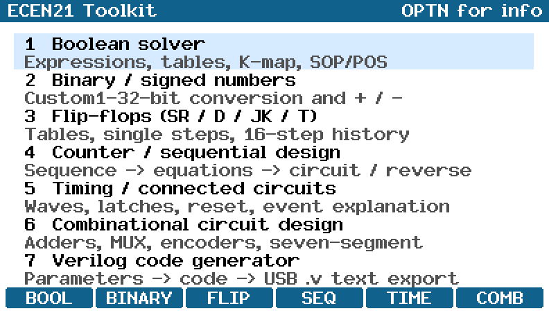
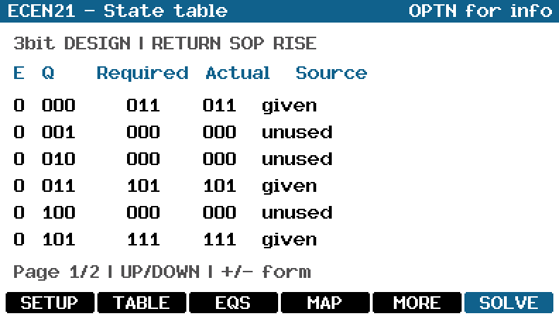
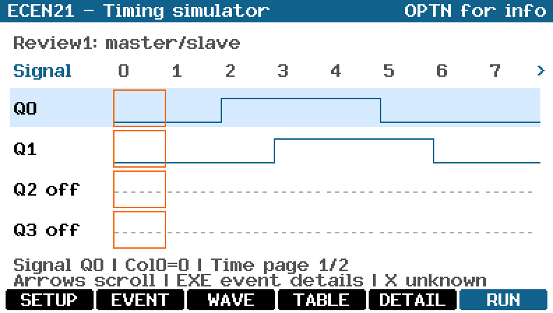
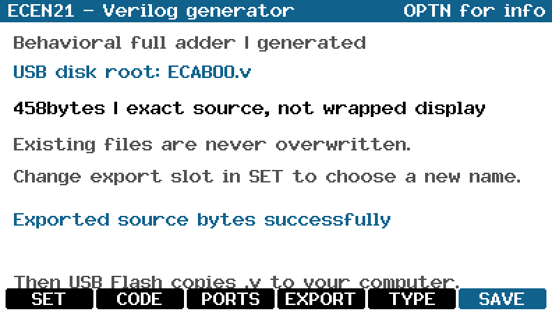

# ECEN21 Toolkit 中文使用手册

**适用：Casio fx-CG50 | M8 工程版 | 手册版本 1.0 | 2026-11-12**

这是一份日常使用手册，不要求你会编译、Git 或电脑测试工具。跟着按键和例题即可使用。屏幕上的界面为英文，本手册给出中文解释。

本手册对应的用户程序为 `ECEN21.g3a`，大小 **158,376 字节**。它包含 7 个工具入口。M8 是开发阶段编号，不是首页工具数量。本次只编写文档，没有增加功能或改变程序。

> 版本状态：原 M2A-M4 已由用户确认实机验收通过；M5/M6 实机验证暂缓；自定义位宽更新、M7/M8 仍待用户验收。当前整合 M8 工程版经过电脑和计算器模拟器检查，但不应被称为已通过整机实机验收的稳定发布版。M9 尚未开始。

## 阅读导航

- 第 1 章：安装、启动、退出和保存规则。
- 第 2 章：七个工具怎么选，按键和符号怎么读。
- 第 3 章：Boolean Solver - 布尔表达式、真值表、K-Map、SOP/POS。
- 第 4 章：Binary - 自定义 1-32 位、进制转换、补码与加减法。
- 第 5 章：Flip-Flops - 单触发器表格、步进和记录。
- 第 6 章：Counter / Sequential - 计数器设计与反向分析。
- 第 7 章：Timing - 时序事件、Latch、连接电路及波形。
- 第 8 章：Combinational - 加法器、MUX、Encoder、七段显示。
- 第 9 章：Verilog - 参数化代码生成、翻页和文件导出。
- 第 10 章：常见问题、报错、故障反馈。
- 第 11 章：能力上限、验证状态、文件和版本恢复。
- 第 12 章：常用词汇和学习路线。

## 1. 安装与第一次运行

### 1.1 找到正确的程序

当前安装文件在项目中的长期归档位置：

`releases/engineering/M8/ECEN21.g3a`

在本机完整路径为：

`/Users/maggie/casioCalcApps/releases/engineering/M8/ECEN21.g3a`

你也可以在个人 GitHub 仓库的 `releases/engineering/M8/` 文件夹下载它。请下载实际的二进制文件，不要把网页另存为同名文件。页面上若有 Download raw file，可用它下载。

不要安装 `EC21Test.g3a` 或 `EC21Bench.g3a`。它们是开发检查用程序，不是用户工具箱。已有同名旧版时，先保留旧文件，再决定替换。

### 1.2 安装到 fx-CG50

1. 打开计算器，用 USB 数据线连接 Mac。
2. 计算器询问连接模式时，按屏幕提示选择 **USB Flash**，通常为 F1。
3. 在 Mac Finder 中打开计算器磁盘。
4. 把 `ECEN21.g3a` 拖到磁盘最外层，不要放进 `@MainMem`。
5. 等复制完成，在 Mac 上安全弹出计算器磁盘，再拔掉 USB 线。
6. 回到计算器系统主菜单，选择 ECEN21 图标并按 EXE。
7. 正确的当前版本首页应有 **1-7 七个工具**，第 7 项为 Verilog code generator。

Mac 快速找文件：在 Finder 按 Command+Shift+G，粘贴上述文件夹路径并回车。无需打开终端，也无需自己生成 `.g3a`。

### 1.3 退出与保留数据

- 在普通工具页面按 EXIT：返回 ECEN21 首页。
- 在首页按 EXIT：退出 ECEN21，回到计算器系统。
- 从首页再进入刚才的工具，通常保留本次运行中的题目和页面。
- 完全退出再重新打开程序，题目回到默认状态。**没有自动保存所有题目的功能。**
- 编辑窗口中的 EXIT 一般是取消当前编辑；Verilog 导出预览中的 EXIT 是先取消预览。关掉这些窗口后，再 EXIT 才离开工具。
- Verilog 已成功导出的 `.v` 文件属于磁盘文件，退出程序后仍保留；这不等于题目编辑状态被保存。

## 2. 首页、按键与符号

图：当前 M8 程序在计算器模拟器中的真实页面。截图用于说明界面，不代表实机测试。

### 2.1 按题型选择工具

| 首页数字 | 屏幕名称 | 适合的问题 |
| --- | --- | --- |
| 1 | Boolean solver | 化简表达式；真值表、K-Map、SOP/POS、Don't Care |
| 2 | Binary / signed numbers | 进制转换、补码、固定宽度加减法、进位和溢出 |
| 3 | Flip-flops | 单个 SR/D/JK/T 的特性表、激励表与逐步状态 |
| 4 | Counter / sequential design | 状态循环设计计数器、混合触发器、E 控制、方程反向分析 |
| 5 | Timing / connected circuits | Latch、时钟沿、主从结构、级联时钟、复位与波形 |
| 6 | Combinational circuit design | 加法器、MUX 接法、Encoder、七段显示、逻辑门连接 |
| 7 | Verilog code generator | 根据结构参数生成完整 Verilog 并导出 `.v` 文件 |

首页直接按数字即可；上下键选中工具后按 EXE 也可以。首页 F1-F6 分别打开前六项；第七项用数字 7 或方向键选择。**进入工具后，F 键含义会改变，以底部按钮为准。**

### 2.2 通用操作约定

| 按键／文字 | 中文说明 |
| --- | --- |
| EXE | 确认、编辑选中设置或执行当前动作；作用取决于页面 |
| UP / DOWN | 上／下方向键，选择字段、行、组或翻页 |
| LEFT / RIGHT | 左／右方向键，选择输入端、组件、列或移动编辑光标 |
| AC | 计算器 AC/ON 键；在编辑中通常清空当前内容 |
| DEL | 删除；文字编辑中通常删除光标前一位，时序事件页则删除事件 |
| OPTN | 进入该工具的示例、题型或帮助菜单 |
| SET / SETUP | 设置题目条件 |
| RUN / CALC / BUILD | 运行、计算或生成；不是一个统一含义的“下一步”按钮 |
| Page 2/3 | 当前第 2 页，共 3 页；必须翻页才能看完 |
| No current result / code | 当前没有有效结果；先修正输入并重新计算 |

选择新示例或新题型会替换该工具当前的题目。仅切换显示页通常不改变题目。编辑实际参数后，旧答案会失效，防止误用。部分工具的设置是循环切换，不是直接键入。

### 2.3 表达式按键，不用 ALPHA

在布尔表达式、顺序电路方程或组合逻辑表达式编辑器中：

| 想输入 | 直接按计算器哪个键 | 含义 |
| --- | --- | --- |
| A | X,θ,T | 第一个逻辑变量 |
| B | log | 第二个逻辑变量 |
| C | ln | 第三个逻辑变量 |
| D | sin | 第四个逻辑变量 |
| `+` | 加号 | 或 OR |
| `*` | 乘号 | 与 AND；有的编辑器也接受 `AB` 表示 A 与 B |
| `^` | 幂键 | 异或 XOR，不是乘方 |
| `!` | 除号 | 前缀“非”，例如 `!A` |
| `'` | 小数点键 | 后缀“非”，例如 `A'` |
| `(`、`)` | 左右括号键 | 改变运算次序 |

通常优先级为：括号、非、与、异或、或。新输入会追加或插入原内容；重新输入题目时先 AC。方程长度上限通常 79 字符。各编辑器是否支持移动光标见对应章节。

**同一个键在别的页面含义不同：**Binary 输入时小数点不是“非”；状态循环编辑时小数点插入逗号；时序事件表的点号表示保持原输入。

### 2.4 四种 X 与两个复位概念

| 出现位置 | X／操作真正表示什么 |
| --- | --- |
| 真值表、K-Map 的 X | 不关心输出；允许化简器自由选 0 或 1 |
| 激励表的 X | 该触发器输入用 0 或 1 都能达到目标状态 |
| 时序波形或 Verilog 的 X | 当前逻辑状态未知；不能直接当成 0 |
| 表中 `!` / undefined | 状态未定义，不是布尔“非”运算的结果值 |
| 单触发器工具 F4 RESET | 重新初始化分析状态、清空记录；不是自动加了实体复位引脚 |
| Timing / Verilog 的 reset | 电路中明确建模或生成的复位信号，可能同步或异步 |

## 3. Boolean Solver：表达式到 SOP/POS 与 K-Map

### 3.1 能做什么

支持 2、3、4 个变量，表达式与可编辑真值表，输出可为 0、1、X。计算精确 SOP（与或式）和 POS（或与式），显示分组及变量消去说明。所谓精确，是先让项数最少，再让变量出现次数最少；不是保证实际门电路器件数最少。

变量 A 是最高位。例如四变量第 6 行就是 ABCD=0110；三变量第 6 行是 ABC=110。必须同时看变量数和行号，不能只记十进制行号。

### 3.2 页面按键

| 页面／按键 | 作用 |
| --- | --- |
| F1 | 表达式编辑；左右移动光标，DEL 删除光标前字符，AC 清空 |
| F2 | 真值表；上下选行，EXE 循环 0→1→X→0 |
| F3 | K-Map；方向键选格，EXE 修改同一份数据 |
| F4 | 打开结果；已经在结果页时再按 F4 切 SOP/POS |
| F5 在表达式页 | USE EX：明确以表达式重建数据，丢弃手动表格修改 |
| F5 在真值表页 | VARS：按 4→2→3→4 循环变量数 |
| F5 在结果／图页 | 查看分组；分组页 F5 返回 K-Map |
| F6 | 求解；在表达式页 EXE 也可计算 |
| 分组页方向键 | 选择不同分组；K-Map 中加减号也可选组 |
| 结果页上下键 | 长公式翻页 |

EXPR 表示当前真值数据来自表达式；MANUAL 表示已经手动编辑表格。切到 F1 看一眼，不会自动把手动 X 恢复为旧表达式；需要主动按 USE EX。

### 3.3 例题一：化简 AB+C

从首页按 1。若已经在本工具中改过数据，先 OPTN、1 恢复默认示例。

1. 按 EXE，得到与 `C+AB` 等价的 SOP。
2. 应显示 2 terms、3 literals。terms 是乘积项数，literals 是变量出现总次数。
3. 默认四变量，D 未出现但仍保留在 16 行表中，已核对的 cared rows 为 16。
4. 在结果页再按 F4，POS 为与 `(B+C)*(A+C)` 等价的形式，2 个子句、4 次变量。
5. 按 F5 看分组，上下键访问每组；页面会给出该组覆盖哪些行、哪些变量固定或可变。

精确最优解有时不唯一；项排列或等价表达式不同，不一定是错误。当前算法的排序是确定的，但解题时应核对逻辑等价性。

### 3.4 例题二：Don't Care 如何减少变量

1. OPTN、3 加载两变量例子；F6 求解，F4 看结果。
2. 表中 row0=X、row1=1，其余为 0。SOP 可化为 `A'`。
3. 若 F2 选 row0，按 EXE 把 X 改为 0，再 F6、F4，SOP 应为 `A'B`。
4. 差别来自 row0 是否允许自由选择，不是程序忽略了输入。

全为 X 时，SOP 可能选 0，POS 可能选 1；没有任何固定输出要求时二者都合法。不要把 X 理解为“必定输出 0”。

### 3.5 示例菜单与边界

| OPTN 后数字 | 示例 |
| --- | --- |
| 1 | 默认 AB+C |
| 2 | 精确化简反例，SOP 为 3 项、9 次变量 |
| 3 | 两变量 Don't Care |
| 4 | 四变量异或，长公式和多个分组 |
| 5、6 | 常数 0、常数 1 |

减少变量数不是代数消元。手动表格只保留低编号行，已丢弃的高行不会在扩回变量数时自动恢复；表达式模式中，超出变量范围的符号会报错。错误字符位置从 1 开始显示。输入 `A+` 缺少右侧内容，补入 B 后再计算即可恢复。

## 4. Binary：自定义位宽、补码与加减法

### 4.1 先选位宽、解释方式和进制

支持任何 **1-32 位整数宽度**，例如课程中的 4、5、10、12 位。支持加减法，不包含乘除、64 位或其他负数编码。

| 屏幕按钮 | 作用 |
| --- | --- |
| F1 BASE | DEC→HEX→BIN→DEC 循环；改变输入进制，保留位图 |
| F2 +/- | 加法／减法切换 |
| F3 SIGN | UNSIGNED 无符号／SIGNED 补码有符号切换 |
| F4 WIDTH | 打开位宽窗口，输入 1-32 后 EXE；F1/F2/F3 快选 8/16/32，EXIT 取消 |
| F5 | 输入页／结果页切换；不会代替计算 |
| F6 或 EXE | 计算 |
| 输入页 UP/DOWN | 选择 A 或 B；AC 清空选中的数，DEL 删除末位 |
| NEG 或减号键 | 在有符号十进制输入负号 |

十六进制 A-F 直接用 X,θ,T、log、ln、sin、cos、tan，不用 ALPHA。DEC 中输入数学数值；BIN、HEX 中输入原始位图。例如 8 位 signed 的 HEX `FF` 表示 -1，而不是十进制 255。

宽度为 w 时：无符号范围是 0 到 2^w-1；有符号范围是 -2^(w-1) 到 2^(w-1)-1。1 位 signed 只有 -1、0 两种值；不能输入 +1。

### 4.2 位宽改变会发生什么

- unsigned 扩宽补 0；signed 扩宽补符号位，负数尽量保持原值。
- 缩小位宽保留最低若干位。值改变时出现橙色 `Width reduction changed an operand value`。
- 扩回旧宽度不能找回已经丢弃的高位。
- HEX 位数向上取整：5 位显示两位十六进制，但合法原始范围只有 00-1F；20 仍超范围。
- 任一操作数标红时，先修复两个操作数，再切进制、符号或位宽。否则会提示 Fix both operands。

### 4.3 例题一：5 位无符号 31+1

1. 首页 2；OPTN、1 恢复默认 8 位 255+1。
2. F4、5、EXE 改成 5 位。A 变为 31、B 为 1，并提示缩短改变了值。
3. EXE：DEC=0、HEX=00、BIN=0 0000，Carry=1。
4. F5 回输入页；用上下键选择 A/B，AC 后输入你自己的数。若输入 32，必须报超范围。

这里的结果只保留 5 位；进位告诉你数学结果 32 放不进这个宽度，不表示 31+1 在普通整数意义上等于 0。

### 4.4 例题二：5 位 signed 的 15+15

1. 保持 5 位，进入输入页，把 A、B 分别清空并输入 15。
2. F3 切到 SIGNED，EXE 计算。
3. DEC=-2、HEX=1E、BIN=1 1110；Signed overflow=1，Carry=0。

Carry 和 signed overflow 是两个不同条件。减法显示 Borrow；加法的 Borrow、减法的 Carry 为 N/A，不适用。

### 4.5 例题三：4 位的 -5 与 10 位的 -281

1. OPTN、8 加载 -5 示例；F4、4、EXE，A 的 BIN 应为 1011、HEX 为 B、DEC 为 -5。
2. F4、1、0、EXE 改到 10 位；确认 A 被选中，AC、NEG、2、8、1。
3. A 的 BIN 应为 10 1110 0111，DEC=-281。

如果想只做单数转换，可把 B 设为 0，直接看输入页的转换；不用每次都做加法。空着 B 会使部分设置操作被阻止。

### 4.6 内置示例

OPTN 后 1-8 依次为：8 位 unsigned 255+1；8 位 signed 127+1；8 位 unsigned 0-1；8 位 signed -128-1；16 位 signed 32767+1；32 位 unsigned 最大值+1；32 位 signed 最大值+1；8 位 signed -5 转换。

`Wrapped result` 表示该解释方式的结果超范围后发生截留。它不是额外的负数编码。此工具使用二进制补码，不生成原码或反码的完整解题步骤。

## 5. Flip-Flops：单触发器的下一状态与激励

### 5.1 模型和按键

SR 为同步、高电平有效的触发器，不是电平 Latch。默认进入 D、Q=0、上升沿、D=0、RISE 事件。

| 按键 | 作用 |
| --- | --- |
| F1 TYPE | SR→D→JK→T→SR 循环；默认 D 下一次是 JK |
| F2 VIEW | Simulation→Characteristic→Excitation→History 循环 |
| F3 EDGE | 有效边沿 RISE／FALL 切换 |
| F4 RESET | 提示后按 0/1 重新设置当前／初始 Q，并清空历史；EXIT 取消 |
| F5 EVENT | RISE→FALL→NONE→RISE 循环事件 |
| 模拟页 1 | 翻转第一个输入：D、T、J 或 S |
| 模拟页 2 | 翻转第二个输入 K 或 R，仅 JK/SR 使用 |
| 模拟页 EXE/F6 | 执行一步并记录；预览不会自己执行 |
| 表格／历史 UP/DOWN | 选行和跨页；最多 16 条事件记录 |
| OPTN | 帮助，任意键返回 |

改变类型会清空记录、输入归零、Q 回到已设定的初始值、事件回 RISE；有效边沿保留。F4 重新初始化时保留当前输入、边沿和事件，执行前必须看一眼。

### 5.2 两张表分别解决什么

| 表 | 你已知什么 | 程序回答什么 |
| --- | --- | --- |
| Characteristic 特性表 | 当前 Q、触发器输入 | 有效边沿后 Q+ 是多少 |
| Excitation 激励表 | 当前 Q、目标 Q+ | 应给什么触发器输入 |

| 目标变化 | D | T | JK 的 J,K | SR 的 S,R |
| --- | --- | --- | --- | --- |
| 0→0 | 0 | 0 | 0,X | 0,X |
| 0→1 | 1 | 1 | 1,X | 1,0 |
| 1→0 | 0 | 1 | X,1 | 0,1 |
| 1→1 | 1 | 0 | X,0 | X,0 |

激励表里的 X 是合法任意输入。SR 的 S=R=1 不是任意输入，而是非法组合。

### 5.3 例题：JK 连续翻转

从首次打开的默认 D 开始：

1. 首页 3；F1 切到 JK。
2. F4、0 初始化；确认 Active 和 Event 都是 RISE，必要时用 F3/F5调整。
3. 数字 1、2，使 J=K=1。
4. EXE：Q=1，动作 Toggle；再 EXE：Q=0。
5. F2 查看特性表，再 F2 查看激励表，再 F2 看两条历史，F2 回模拟。

### 5.4 无效时钟、SR 锁定与满记录

事件与 Active 边沿不同，或 Event=NONE 时保持 Q；仍会记录该事件。只有 Active 对应边沿才能采样。

SR 输入 11 在有效边沿执行后，Current Q 显示 undefined，并锁住继续模拟。只修复 S/R 不够，必须 F4 后按 0/1 重新初始化。之后再执行新事件。

记录上限为 16；第 17 次明确报 History full，不会覆盖前 16 条。F4 清空可开始新的记录。若需要更长、多器件或真实复位信号的时序题，转到第 5 项 Timing。

## 6. Counter / Sequential：从状态要求设计电路

### 6.1 范围与求解流程

支持 2 或 3 个状态位，可选一个控制输入 E；每位可独立用 D/T/JK/SR，统一共享 RISE 或 FALL 时钟。流程是：输入循环或原输入方程，生成状态表、激励表、方程、K-Map、轨迹、恢复分析和实际接线。

图中 Required 是题目规定，Actual 是选定 SOP/POS 电路的实际结果。不要只复制方程而忽略未使用状态的行为。

### 6.2 操作和设置字段

| 按键 | 作用 |
| --- | --- |
| F1 | 设置；UP/DOWN 选字段，EXE 修改或进入文字编辑 |
| F2 | 从状态表开始循环：状态表→激励表→输出表；从其他页按 F2 先回状态表 |
| F3 | 当前选中触发器输入端的方程 |
| F4 | K-Map；上下换组，EXE 查看／退出分组说明 |
| F5 | 更多菜单：1轨迹，2接线，3恢复，4输出表，5帮助 |
| F6 | 求解；成功后回状态表 |
| 结果页 LEFT/RIGHT | 选择 D2、T1、J0、K0 等输入端 |
| 结果页 UP/DOWN | 翻页；图页改选分组 |
| 结果页加号／减号 | 切换 SOP/POS 的完整实现和 DC 补全 |
| OPTN | 选择示例 1-8；其他键取消 |

| 设置名称 | 要填什么 |
| --- | --- |
| Problem mode | DESIGN from cycles 正向设计，或 REVERSE equations 反向分析 |
| State bits | 2 或 3；决定状态合法范围 0-3 或 0-7 |
| Control E | 无控制或启用 E=0/E=1 两支 |
| Clock edge | 共用 RISE／FALL |
| Unused states | RETURN／HOLD／DC |
| Recovery state | RETURN 策略要回到的状态 |
| Initial state | 轨迹分析起点及初始化要求，不是自动生成复位电路 |
| Fixed trace E | 受控题固定使用 0 或 1 分析轨迹 |
| Q2/Q1/Q0 flip-flop | 每位触发器类型；两位题没有 Q2 |
| Cycle E=0 / E=1 | 设计模式的状态循环 |
| Input T1 / J0 等 | 反向模式原电路的触发器输入方程 |
| Output Z0 / Z1 | 可留空；非空时为当前状态输出方程 |
| E timeline | 启用 E 时可填写最多 32 个 0/1，每个有效时钟使用一位；空则用固定 E |

字段随模式、位数、类型变化。**用屏幕字段名定位，不要死记“按几次 DOWN”。** 文本框支持左右光标、DEL、AC；EXE 保存，EXIT 取消。循环文本最多 31 字符，输入方程最多 79 字符。

### 6.3 输入状态循环与未使用状态

三位状态按 Q2Q1Q0 解释，000=0、011=3、101=5、111=7。循环可输入 `03570`，也可用小数点键输入逗号得到 `0,3,5,7,0`。末尾重复首状态可用于闭环；内部不能重复同一个状态，每支至少两个不同状态。

| 策略 | 未使用状态怎样处理 | 应注意 |
| --- | --- | --- |
| RETURN | 回到 Recovery state | 仍需看恢复分析，不能凭名称假设最终进入要求循环 |
| HOLD | 保持原状态 | 未使用状态通常形成陷阱 TRAP |
| DC | 由化简器选择补全 | 不保证恢复；SOP/POS 补全可不同，必须查看 Actual |

### 6.4 例题一：T 型循环 0→3→5→7→0

1. 首页 4；OPTN、1 恢复默认例题，F6 求解。
2. F2 在激励表看各 T 输入；左右选到 T0。
3. F3 查看 T0 方程。映射 A=Q2、B=Q1、C=Q0；SOP 可为 `A'B'+ABC`。
4. F4 看 K-Map，EXE 看组的固定变量和覆盖行。
5. F5、1 看轨迹，应为 0、3、5、7、0，Prefix=0、Period=4。
6. F5、2 看接线。所有触发器共享一个时钟，初始状态要求与每根输入端的门节点连接均列出。
7. F5、3 看未使用状态 1、2、4、6 的恢复路径。

自己改题：OPTN、1 回设置，用 DOWN 找 Cycle E=0，EXE、AC 输入新循环，EXE 保存后 F6。输入 `0305` 会因内部重复状态 0 报错；改回合法循环再 F6。

### 6.5 例题二：JK、混合类型和 E 控制

| 示例操作 | 题目与预期轨迹 |
| --- | --- |
| OPTN、2、F6、F5、1 | JK：0→1→4→7→3→5→0 |
| OPTN、3、F6、F5、1 | Q2=D、Q1=T、Q0=JK：0→3→1→2→5→4→7→6→0 |
| OPTN、4、F6、F5、1 | 控制 E 的两位计数器，固定 E=0：0→2→3→1→0 |

要看 E=1：F1 找 Fixed trace E，EXE 改成 1，再 F6、F5、1；应为 0→1→3→2→0。启用控制后，两个分支都要填完整，不能只设置轨迹的 E 值就当作输入了第二支循环。

如果 E timeline 为 `0101`，则四次时钟分别用 0、1、0、1。本例从 0 出发轨迹为 0→2→0→2→0；程序显示时间序列结束，不会仅因 Q 重复就推断控制系统永远循环。

### 6.6 例题三：给定方程反推状态

1. OPTN、5、F6。题目为两位混合 T/JK，映射 A=Q1、B=Q0。
2. 输入方程：T1=`B+!A`，J0=`!B*A`，K0=`!B+A`；输出 Z0=`B`，Z1 留空。
3. 状态表应为 00→10、01→11、10→11、11→00。
4. 从状态表 F2 两次，Z0 为 0、1、0、1；未指定 Z1 显示减号，不是强行设成 0。
5. F5、1：从 0 出发为 0→2→3→0。

自己填方程时，A/B/C/D 代表页面列出的状态位及 E，不一定是某根触发器输入。例如三位加 E 通常 A=Q2、B=Q1、C=Q0、D=E；以屏幕映射为准。输出表是**当前状态、边沿前**的输出，不是自动延后一拍的输出。

### 6.7 同步更新、恢复与限制

OPTN、7 是两个 D 触发器交换：01→10→01。两颗都读取同一份旧 Q，不能先更新一颗再让另一颗读取新值。OPTN、8 是 SR 非法输入例子：S=R=1 时下一状态为 `!`，轨迹停止。

恢复页的 Prefix 是进入周期前的步数，Period 是周期长度。TRAP 表示不能进入给定循环；INVALID 表示轨迹遇到未定义状态。三位加 E 共 16 行，需要翻完，不能只看前 8 行。

本工具不设计超过三位的计数器，也不处理 Latch、异步复位或不同器件独立时钟。那些时序行为应在 Timing 观察；M8 虽能生成更宽计数器代码，也不意味着本工具能综合同样宽度的任意状态循环。

## 7. Timing：连接电路、事件与波形

### 7.1 先理解时间轴

支持 D/T/JK/SR 边沿触发器，以及 D/SR 电平 Latch；最多 4 个外部输入 I0-I3、4 个状态器件 Q0-Q3、4 个逻辑门 G0-G3、64 次输入事件。加初始状态共有 65 列。

一列表示一次输入事件，不是固定几秒。Col0 为初始化后的状态，没有凭空出现的时钟沿。同一行内外部输入同时变化，再执行采样与内部更新。若希望 D 比时钟提前稳定，把 D 和时钟变化放在两行。

图：主从 Latch 示例。横向时间格宽用于阅读，不是器件传播延迟测量。

### 7.2 按键与组件设置

| 按键／页面 | 作用 |
| --- | --- |
| F1 SETUP | 配置电路；左右选外部输入、Q0-Q3、G0-G3；上下选字段；EXE 循环值 |
| F2 EVENT | 编辑事件；左右选 I0-I3，上下选行 |
| 事件页 0／1／2 | 设为 0／1／保持原值；点号表示保持 |
| 事件页 EXE | 循环保持→0→1；F5 追加全保持事件，DEL 删除行，AC 清空全部事件 |
| F3 WAVE / F4 TABLE | 波形／精确数值表；左右移动事件列，上下选信号 |
| F5 DETAIL | 事件说明；但事件页 F5 是追加，不是说明 |
| EXE 在波形／表格 | 进入事件说明；再 EXE 看内部更新点 |
| 内部更新点 UP/DOWN | 查看同一事件内的逐次更新；左右换事件，F3 回波形 |
| F6 RUN | 校验并重算；修改电路或事件后必须重算 |
| OPTN | 0-9 示例；EXE 帮助，其他非数字键取消 |

外部输入组件可设 I0-I3 初始电平。状态器件有以下字段：

| 设置 | 说明 |
| --- | --- |
| Enabled / Type / Initial Q | 是否启用、器件类型、初始 Q=0/1/X |
| Input A | D/T/J/S 的输入来源 |
| Input B | K/R 的输入来源；D/T 不使用这个端口 |
| Clock / enable | FF 时钟或 Latch 使能来源 |
| FF active edge | RISE / FALL，仅边沿器件使用 |
| Latch transparent | HIGH / LOW，仅 Latch 使用；有效电平期间跟随输入 |
| Reset mode | NONE / SYNC / ASYNC |
| Reset source / active / Q value | 复位信号来源、有效高低电平、复位后的 0/1 |

来源可选 I0-I3、Q0-Q3、G0-G3 或常量 0、1，EXE 循环到所需名字。门组件可启用 NOT、AND、OR、XOR、NAND，并指定两根来源；NOT 只使用第一根。引用未启用组件会报错。

### 7.3 看懂 Latch、复位与内部阶段

| 名称／标记 | 含义 |
| --- | --- |
| Capture D | 在有效边沿采样 D |
| Transparent | Latch 处于透明电平，输入变化可传到输出 |
| Hold | 本次保持 |
| Toggle | 翻转 |
| Sync reset | 复位在有效时钟／透明使能条件下生效 |
| Async reset | 时钟沿之间也可立即生效 |
| `I0^` / `I0v` | 来自 I0 的上升沿／下降沿 |
| `I0H` / `I0L` | I0 为高／低时 Latch 透明，不是时钟边沿 |
| `I0:0>1` | 输入在本次事件从 0 变 1 |
| Phase point | 同一事件内部的更新快照，不是额外时钟周期 |

异步复位优先于该器件正常输入。同步复位只在 FF 有效沿生效；对 Latch，SYNC 由透明使能电平限定。不要把图纸上的低电平小圆圈自动理解为异步复位。

OPTN 示例按数字直接载入；载入后 F6 运行。每个示例会替换当前 Timing 设置和事件，先记下自己的题目。

| 数字 | 示例用途 |
| --- | --- |
| 0 | 4 颗 T 触发器、64 个事件的上限例子 |
| 1 | Review 1：主从 Latch |
| 2 | Review 2：Latch、正沿和负沿对比 |
| 3 | Review 3：派生时钟的级联变化 |
| 4 | Review 4：4 颗同步 T 触发器 |
| 5 | Review 5：反馈产生的同步复位 |
| 6 | 同步与异步复位对比 |
| 7 | SR 非法状态与 X 传播 |
| 8 | 电平敏感 SR Latch |
| 9 | 不稳定反馈的错误检查 |

### 7.4 示例一：主从 Latch

1. 首页 5；OPTN、1、F6 恢复主从例子并运行。
2. RIGHT 两次到 Col2：Q0=1、Q1=0。主 Latch 跟随 D，从 Latch 保持。
3. EXE 看原因，再 EXE 看更新点；DOWN 能看到 Q0 从 0 变 1，而 Q1 仍为 0。
4. F3、RIGHT 到 Col3：Q1=1。
5. F4 数值表可核对波形；信号按 I、Q、G 分组翻页，关闭行显示 off／灰虚线或减号，不能把它当作活跃的未知 X。

### 7.5 示例二：同步、异步、级联时钟

| 操作 | 应观察到什么 |
| --- | --- |
| OPTN、2、F6 | 同一 D 驱动高电平 Latch、正沿 D、负沿 D，观察三者不同 |
| OPTN、3、F6、RIGHT、F5、EXE | 级联时钟内部 Q2Q1Q0：000→001→011→111；DOWN 逐点查看 |
| OPTN、5、F6，RIGHT 九次、F5 | 状态到 101，低有效反馈复位 G1=0，但同步器件尚未清零 |
| 接上行 RIGHT 两次 | Col11 的有效沿才清零，三行原因均 Sync reset |
| OPTN、6、F6，RIGHT 三次、F5 | Col3：同步 Q0 仍为 1，异步 Q1 已为 0 |

某些 Review 按 Q0 在前写状态，而数值通常按 Q2Q1Q0。请先核对位序。例如 Q0Q1Q2=111、011、101……与最高位在前的 7、6、5……是同一轨迹的不同排列。

### 7.6 自己输入一个 D 触发器时序题

下面从内置例子 6 改出“D 先变，后遇到上升沿”的单 D 电路，初始输出 0。

1. OPTN、6 加载复位对比例子。F1 设置页的当前组件为外部输入。
2. RIGHT 两次选 Q1，停在 Enabled；EXE 关闭 Q1。本例没有启用门，因而不会遗留引用 Q1 的门。
3. LEFT 选 Q0，DOWN 三次选 Input A。它原为常量 1，EXE 两次循环到 I1。
4. DOWN 五次到 Reset mode，原为 SYNC，EXE 两次改为 NONE。Q0 的时钟仍为 I0、正沿、初始 Q=0。
5. F2、AC 清空时间轴；F5 加第一行。RIGHT 选 I1，按 1，表示 D 先置 1。
6. LEFT 回 I0；F5 加第二行，按 1，表示随后时钟上升。没有指定的输入用点号保持原值。
7. F6：Col0 时 Q0=0；Col1 时 D=1、Q0 仍为 0；Col2 时 Q0=1。F4 可看精确数值。

同批变更的规则是“先应用该行全部外部输入，再采样”。因此把时钟与 D 都放第一行，会让采样看到新 D；如果题目另有约定，应拆成不同事件输入。

### 7.7 X、SR 与不稳定反馈

OPTN、7 展示 SR 非法输入产生 X，并影响下一颗 D；之后确定的清零／采样可以恢复已知值。OPTN、8 是高电平敏感 SR Latch，置位、非法、复位不必都等新时钟沿。

本工具和单触发器工具的 SR 错误处理不同：这里传播未知 X，不是强制进入必须手动初始化的锁定模式。不要跨模块照搬一种含义。

每次事件最多 32 次内部稳定更新。OPTN、9、F6 的反相透明反馈没有稳定状态，应报 No stable state，不显示旧波形。修改错误电路，或 OPTN、1、F6 重新开始。纯门组合环路也会被拒绝。

此模型不模拟器件真实传播延迟、亚稳态或建立／保持时间；一个抽象 X 持续不变，不会被解释成其中藏着无数时钟沿。64 次已满时，F5 追加会拒绝；空时间轴运行后只显示合法初始列。

## 8. Combinational：从题目到实际连接

### 8.1 七种题型与通用操作

首页 6；OPTN 选题型 1-7，9 看帮助，其他键取消。每次新选题型会替换当前组合题。

| 菜单数字 | 题型 |
| --- | --- |
| 1 | Half adder 半加器 |
| 2 | Full adder 全加器／P4.12 |
| 3 | 三个输入中 1 的数量／P3.21 电路部分 |
| 4 | 自定义真值表／表达式实现 |
| 5 | Ordinary encoder 普通编码器 |
| 6 | BCD seven-segment 七段显示 |
| 7 | Ripple-carry 逐级进位结构 |

| 按键／页面 | 操作 |
| --- | --- |
| F1 SET | 上下选设置，EXE 编辑或循环值；多输出题在 Output 切换 |
| F2 TABLE | 真值表或加法级表；方向键选行和翻页 |
| F3 EQ | 当前输出的方程；上下查看长公式 |
| F4 KMAP | 当前输出的 Gray 图；上下切换高亮组 |
| F5 CIRCUIT | 接线页；上下翻页 |
| 接线页 EXE | 接线→MUX 数据端→验证→接线循环；MUX 页上下换 D0、D1 等 |
| F6 RUN | 计算当前选择的输出；从设置页运行成功后进方程页 |

多输出题一次处理一个输出。改变 Output 后按 F6；同一题的其他设置保留。每个输出的 N 节点编号是局部编号，不能把 Sum 页面 N5 与 Carry 页面 N5 直接当成同一根线。

### 8.2 全加器、半加器和三输入计数

全加器中 A=x0、B=y0、C=c0。按行 000-111：

| 输入 x0 y0 c0 | Sum | Carry |
| --- | --- | --- |
| 000 | 0 | 0 |
| 001 | 1 | 0 |
| 010 | 1 | 0 |
| 011 | 0 | 1 |
| 100 | 1 | 0 |
| 101 | 0 | 1 |
| 110 | 0 | 1 |
| 111 | 1 | 1 |

基本公式：Sum=A XOR B XOR C；Carry=A*B+(A XOR B)*C。半加器没有 Cin：Sum=A XOR B，Carry=A*B。

三输入计数把全加器 Carry 当 Count1、Sum 当 Count0。例如输入101有两个 1，Count1Count0=10；111有三个 1，输出11。它是组合电路结果，不是已经生成 Verilog。

### 8.3 例题：P4.12 的两个 4:1 MUX

1. OPTN、2、F6，当前默认输出 Sum。
2. F5、EXE 查看 MUX。选择线必须是 S1=x0、S0=y0，第一条是高位选择线。
3. 上下看 D0-D3，Sum 应为 `C、C'、C'、C`，即 `c0、!c0、!c0、c0`。
4. EXE 进入检查，应 PASS。
5. F1 选 Output，EXE 切 Carry，F6；F5、EXE，数据端为 `0、C、C、1`。
6. 接线页把它们命名为 MUX_Sum、MUX_Carry，是两个器件；不要把两个不同输出接到同一根 MUX.Out。

选择线顺序会改变数据端排列。S1/S0 或输入变量次序写反时，即使数据端列表看起来一样，也不一定实现相同函数。

### 8.4 自定义函数与 MUX 选择

F1 中可设 Source=truth table 或 expression、Variables=2-4、Expression、SOP/POS、MUX=2:1/4:1/8:1 和有序 Select slot。

- 手动表中 F2、EXE 循环选中行 0→1→X→0；表达式模式不能用这个动作偷偷修改源表。
- 2:1 需要 1 条选择线，4:1 需要 2 条，8:1 需要 3 条；生效的选择线必须不同，并在变量范围内。
- 2 变量函数不能直接选择需要 3 条不同选择线的 8:1 配置。
- MUX 数据端可能是常量、变量、反变量或剩余变量的函数。程序会给出完整数据端公式及对应门节点，不应只接“一个还没实现的表达式”。
- 对 X 行，当前工具先取选中 SOP/POS 的具体补全，再建立 MUX。因此该次实现的 Gate 和 MUX 在 X 行也相同；它们不必等于你任意猜的 0。

表达式编辑用第 2.3 节按键，AC 清空、DEL 删末位、EXE 应用、EXIT 取消；这个编辑器不是布尔工具那种可移动光标的插入编辑器。最多 79 字符。改变量数会清空手动表的 ON/DC 数据，要重新检查题目。

### 8.5 逐级进位结构

OPTN、7、F6、F2，默认 4 位 A=7、B=1、Cin=0，得到 Sum=8、Cout=0。表中列出每级 x、y、Cin、Sum、Cout；第 0 级是最低位，第 i 级 Cin 接第 i-1 级 Cout。

F1 可设 Width=1-8、A/B=0-255（实际仍须放得进所选位宽）、Cin=0/1。例：8 位 255+1 得 0、Cout=1，向下翻页可看第 5-7 级。缩成 3 位却保留 A=255 会报错；修复后再 RUN。

这是看加法器结构与进位链，不是替代 Binary 的有符号解释与溢出分析，也不是传播延迟计算。

### 8.6 Encoder：先看 Valid 再看 Code

OPTN、5。默认 4 输入，可在设置中改为 8。表格按 I[n-1]…I0 排列，Code 是完整编码值，设置中的 Y0/Y1/Y2 选择要推导的输出位；另有 VALID 接线。

| 输入情况 | 示例 | Valid | 怎样理解 Code |
| --- | --- | --- | --- |
| 没有输入为 1 | 0000 | 0 | ZERO，无有效编码 |
| 只有一个输入为 1 | 0100 | 1 | I2 有效，Code=2 |
| 多个输入为 1 | 0011 | 0 | MULTI，显示实际引脚值但不是有效编码答案 |

本程序没有偷偷采用优先级编码。多输入时 Code 的实际规则为“所有激活输入编号的按位 OR”；例如 I0、I1 同时有效会显示 Code=1，但 Valid=0，不能把它当合法 I1 结果。

八输入共有 256 行。F2 后从 row0 按 UP 可绕到 row255；Inspect input pattern 可直接设十进制 128，看到10000000、Code=7、Valid=1。Encoder 是结构化八输入题型，不代表通用布尔化简器扩展到八变量。

### 8.7 七段显示：极性和非法 BCD 必须先定

OPTN、6。BCD 是四位编码表示十进制 0-9，10-15 是非法数字编码。段的位置：a 顶横、b 右上、c 右下、d 底横、e 左下、f 左上、g 中横。

F1 的 Output 可选 a-g，Pins active 选高／低电平点亮。高电平有效时数字0的 a=1、数字1的 a=0；低电平有效时对应引脚反相。

| BCD10..15 策略 | 引脚处理 |
| --- | --- |
| zero pins | 所有物理引脚设 0；低电平有效时这会点亮，不等于灭屏 |
| blank display | 全部设为关闭对应段的电平；高有效时 0，低有效时 1 |
| don't care | 真值要求 X，允许化简器选择实际输出 |

所有七段都可查看真值、方程、K-Map、门电路与所选段的 MUX。公式 A/B/C/D 对应 B3/B2/B1/B0，而小写 a/b/c 是段名，注意区分。

## 9. Verilog：生成代码与导出文件

### 9.1 操作总表

首页按 7。F5 或 OPTN 打开题型菜单，数字 1-9 换题型，0 看帮助。换题型会替换当前参数与代码；帮助和取消不替换。

| 按键 | 含义 |
| --- | --- |
| F1 SET | 上下选设置，EXE 修改；数值输入 EXE 应用、EXIT 取消 |
| F2 CODE | 查看完整代码；上下或左右翻页，首尾循环 |
| F3 PORTS | 端口、时钟、复位、优先级等说明 |
| F4 EXPORT | 只进入导出预览，不立即保存 |
| F5 TYPE | 换代码题型 |
| F6 BUILD | 根据当前参数生成；不是在计算器上编译 Verilog |
| 导出页 F6 SAVE | 明确确认保存 `.v` 文件 |
| 导出页 EXIT | 取消预览并回原页，再 EXIT 才能返回首页 |

完整代码长行在屏幕折行，导出的原始行不会被改断；不要照屏幕换行重新手抄。程序离线生成代码，但计算器不运行 Verilog 仿真，也不会烧录 FPGA。

### 9.2 九个题型、参数与文件名前缀

| 菜单 | 题型／模块 | 主要设置 | 文件示例 |
| --- | --- | --- | --- |
| 1 | 行为式全加器 ecen21_add_b | WIDTH=1-32，含 Cin/Cout | ECAB00.v |
| 2 | 结构式全加器 ecen21_add_s | WIDTH=1-32，文件内含单位全加器 | ECAS00.v |
| 3 | 普通 Encoder ecen21_encoder | INPUTS=4/8，带 valid | ECEN00.v |
| 4 | D ecen21_dff | 时钟沿、复位方式／极性／值 | ECDF00.v |
| 5 | T ecen21_tff | 同上 | ECTF00.v |
| 6 | JK ecen21_jkff | 同上 | ECJK00.v |
| 7 | 通用移位 ecen21_shift | WIDTH=1-32、时钟／复位 | ECSR00.v |
| 8 | 模 N ecen21_modulo | N=1-65535、足够的 WIDTH、同步复位 | ECMN00.v |
| 9 | 环形 ecen21_ring | WIDTH=1-32、种子位、方向、时钟／复位 | ECRG00.v |

Export slot 为 00-99。以行为式加法器为例，编号 1 得 ECAB01.v。只改 slot 不改变代码，也不用重新 BUILD。

### 9.3 例题一：导出 5 位加法器

1. 首页 7；若已经换过题型，用 F5、1 恢复行为式全加器，默认 Width=5。
2. F6 生成，代码中有 `module ecen21_add_b`、参数 WIDTH 和 a/b/cin/sum/cout 端口。
3. 方向键翻完，F3 看端口说明：bit0 是最低位，sum 为 5 位，cout 为最终进位。
4. F4 看导出预览，检查文件名 ECAB00.v 和字节数。
5. F6 SAVE 后，应出现 Exported source bytes successfully。
6. 如果 File exists，用 F1 找 Export slot，EXE 输入未使用编号，EXE 确认；再 F4、F6。不要为了覆盖而反复按 SAVE。

结构式全加器选 F5、2。文件同时包含 `ecen21_fa1` 和结构式主模块，不需要另外手写单位全加器。

### 9.4 触发器、移位与初值

D/T/JK 可选 rising/falling、NONE/SYNC/ASYNC、high/low，以及复位值 0/1。生成后 F3 核对。

D 在有效沿采样 d；T 为 `q <= q ^ t`；JK 的 00 保持、01 清零、10 置一、11 翻转。没有假定的上电 q=0。NONE 时 rst 虽作为端口存在，但不参与复位；无复位 T 在普通仿真中可能一直为 X，不能假装已有确定初值。

通用移位寄存器优先级为 reset > load > right > left > hold。右移把 serial_left 插入 MSB，左移把 serial_right 插入 LSB。WIDTH=1 也合法；默认通过复位或并行加载建立状态。

### 9.5 模 N 与环形的设置

模 N 只允许同步复位；有效沿复位优先于 enable。q 到 N-1 后下一步回 0；enable=0 保持。默认 N=12、WIDTH=4。若设 WIDTH=1 但 N=12，BUILD 应报位宽不足；把 N 改 1 后就可生成，复位后始终为 0。

生成代码使用安全的最小位宽再加 EXTRA_BITS，使你选择的较宽位数也保留。使用参数覆盖改变 N 时，最小位宽会重算；若组合超出 32 位仍会被拒绝，不能默认无限加宽。

环形计数器种子是“哪一位为 1”，不是直接输入二进制整数。SEED_INDEX=0 是最低位；默认 5 位、向左，复位后为00001，随后00010、00100、01000、10000、00001。WIDTH=1、seed=0 合法；WIDTH=1、seed=31 越界。环形必须有复位，不承诺自动修复任意非法多热状态。

### 9.6 把 `.v` 文件拿到电脑

1. 保存成功后，从导出预览 EXIT 回代码，再 EXIT 回首页，EXIT 回计算器主菜单。
2. USB 连接并选 USB Flash，在计算器磁盘最外层找到刚保存的文件名。
3. 复制 `.v` 到电脑，用普通文本编辑器打开；应有完整模块和 `endmodule`，没有界面页码或错误消息。
4. 安全弹出磁盘，再断开 USB。

同一种题型的不同编号通常拥有相同模块名。**不要把同一家族多个版本同时作为重复模块加入同一次编译。** 一般保留一个源文件，用参数覆盖建立不同位宽实例。结构式文件已自带其单位全加器，也不要重复定义。

你无需安装测试工具来阅读和使用手册。若需要在电脑编译或仿真，属于独立电脑操作；本工程已用实际 HDL 编译器做过检查，但没有做真实 FPGA 综合、布局、时序或烧录验收。

### 9.7 导出错误

| 报错／状态 | 处理方式 |
| --- | --- |
| Generate code before export | 先修复参数并 F6 BUILD |
| File exists | 换 Export slot；原文件未覆盖 |
| Cannot inspect / create / open file | 确认存储可用，记录 IO code；不要把失败当成已保存 |
| Incomplete file write / Cannot close file | 文件不可靠，记录完整提示与文件名；程序会尽力清理本次新建的失败文件 |
| partial cleanup FAILED | 可能留下本次不完整文件；不要作为正常源代码使用，提供照片及文件 |

清理只针对本次新建而失败的文件，不会删除旧文件。真实 USB、写满磁盘和存储异常仍需实体设备确认；手册不会要求你故意把磁盘写满。

## 10. 常见问题与故障处理

### 10.1 为什么我按的 F 键与说明不同

先看当前模块和底部按钮。Boolean 的 F4 是结果／形式；Binary 的 F4 是位宽；Timing 的 F4 是表格；Verilog 的 F4 是导出。示例菜单数字也只在各自工具中生效。

### 10.2 为什么选择新设置后没有旧答案

这是保护机制。输入变了，旧答案不能继续被认为有效。先修复红色输入或报错字段，再 F6。仅打开结果页不会重新计算。取消编辑则应保留旧题，不等同于保存一份空白内容。

### 10.3 为什么同一公式的 SOP/POS 或 X 行结果不同

SOP/POS 逻辑要求相同，但结构表达不同；Don't Care 行可选不同补全。Boolean 的精确目标是项数再变量次数，不是让所有连接形式都拥有最少门。M5 应按选定的完整实现看恢复／陷阱；M7 同一次 Gate/MUX 则使用相同补全。

### 10.4 常见提示速查

| 屏幕文字 | 说明与下一步 |
| --- | --- |
| Invalid digit / Outside selected numeric range | 进制数字不合法或超过当前位宽；修复选中 A/B |
| Fix both operands before settings | 先给两个操作数都填合法值，单数转换时 B 可设 0 |
| Width reduction changed an operand value | 缩小位宽丢弃高位，值确实改变；取消窗口则不会发生 |
| History full | 单 FF 已记录 16 条，F4 重新初始化 |
| undefined / INVALID | 状态未定义；单 FF 用 F4 恢复，时序工具按未知传播规则处理 |
| Repeated internal cycle state | 状态循环内部重复；修改 Cycle 文本 |
| Select variables must be distinct/in range | MUX 选择线重复或越界，修复 SET 中选择配置 |
| No stable state within 32 settling phases | 时序反馈无法稳定；改连接／使能／门，或重载示例 |
| Event limit64 reached | 已满 64 次输入事件；删除不需要的事件或缩短题目 |
| Ring seed<width / sufficient width | 种子位超范围，或计数器位宽装不下 N；修复后 BUILD |

### 10.5 程序、安装或 USB 有问题

先核对文件名、位置、大小及首页是否七项。若下载到的是网页而非二进制，重新下载实际 `ECEN21.g3a`。若计算器没有显示插件，检查是否放在磁盘最外层、是否安全断开并回到系统主菜单。

不要在复制未完成时拔线；不要把测试程序当作工具箱。若程序卡住或异常退出，记录你看到的最后页面和按键，按设备正常操作方式返回系统后再试；不要为了排查手册而格式化磁盘或清空计算器数据。

### 10.6 如何反馈，便于准确修复

请按下面顺序描述，不要求你会 Git 或提供日志：

1. 首页第几项、哪个示例或自定义题，当前页面和输出端。
2. 完整输入：表达式、位宽／进制／符号、状态循环、触发器类型、E、复位等相关参数。
3. 从已知起点按了哪些键；实际结果是什么，预期是什么。
4. 屏幕照片包含顶部状态、数据和底部按钮；导出问题附 `.v` 文件。
5. 完全退出重开后能否重现；计算器型号和系统版本，不知道可写“不知道”。

## 11. 能力上限、验证状态与版本恢复

### 11.1 当前范围一览

| 工具 | 当前上限与边界 |
| --- | --- |
| Boolean | 2-4 变量，79 字符表达式，0/1/X，精确 SOP/POS |
| Binary | 自定义 1-32 位，BIN/DEC/HEX，补码，加减法 |
| 单 Flip-Flop | SR/D/JK/T，一次一个器件，最多 16 条事件 |
| Counter / Sequential | 2-3 状态位，可选 1 个 E，最多 16 行，Z0/Z1，E 时间序列 32 步 |
| Timing | 4 输入、4 状态器件、4 门、64 事件；每事件 32 次内部稳定更新 |
| Combinational | 通用 2-4 变量；1-8 位进位链；普通 4/8 输入 Encoder；BCD 七段 |
| Verilog | 加法器／寄存器／环形 1-32 位，模数 1-65535，slot00-99，源码缓冲小于 8192 字节 |

一个模块上限不能自动套到另一个模块。例如 M8 能生成 32 位计数器寄存器，不代表 M5 能综合任意 32 位状态表；8 输入 Encoder 不代表通用八变量最小化。

### 11.2 当前已经检查什么

当前 M8 程序从源代码构建并在计算器模拟器执行。M8 生成／导出共享检查 92,120 项；独立 Verilog 编译／仿真 343 组、280,704 次行为检查；17 个模拟器实际导出文件核对并进入后续仿真。之前各计算模块和页面也有回归记录。

这些是工程证据，不代替真实计算器按键、USB、长时间运行、物理速度／峰值内存或 FPGA 实现测试。本手册新写了使用说明，不意味着又完成了实机验收，也不自动批准 M9。

### 11.3 找回旧版本

GitHub 已保存完整当前源码、M8 用户程序以及 Phase1、M2A、M2B、原 M3、M4、M5、M6、自定义位宽、M7、M8 共 10 份恢复档案。它们是从真实旧快照补建的档案，不是伪造的历史 Git 提交。

当前本机 M4 用户文件仍位于 `.phase1/milestones/M4/artifacts/ECEN21.g3a`；它与当前 M8 同名，切换版本时要检查所在文件夹，先保留要替换的版本。新克隆中旧阶段文件需从恢复档案取出，不保证所有 `.phase1` 文件夹自动存在。

M8 对应工程源码检查点：`840a04d5f9ff9669767d87e9b4f4574eb17d38cd`，工程标签 `engineering/m8-recovered-p0`；这不是 M8 Accepted Release。当前程序 SHA-256：

`a893609cb6a6757a5b20dbd253495339f3d9c2e6e1a5a13fa7c2ce01480824df`

校验值供版本排查，你不必手工计算。恢复操作、目录和全部文件校验请参照仓库的版本恢复说明；不要为了恢复旧版本使用 destructive reset 或 Force Push。

## 12. 常用词汇与推荐学习路线

| 词汇 | 中文／解释 |
| --- | --- |
| Truth Table | 真值表，每种输入对应什么输出 |
| State Table | 状态表，当前状态和下一状态 |
| Excitation Table | 激励表，为实现状态变化需要的触发器输入 |
| K-Map / Gray order | 卡诺图／格雷顺序，相邻格只变一个输入位 |
| SOP / POS | 与或式／或与式，两种表达形式 |
| Present / Next / Q+ | 当前／下一状态 |
| MSB / LSB | 最高位／最低位 |
| Carry / Borrow / Overflow | 进位／借位／有符号溢出，不能混为一谈 |
| Latch / Flip-Flop | 电平敏感锁存器／边沿触发器 |
| MUX / Encoder | 多路选择器／编码器 |
| BCD | 用四个二进制位表示十进制 0-9 的编码 |
| Clock / Reset / Enable | 时钟／复位／使能 |
| Width / Modulus / Seed | 位宽／模数／环形计数器种子 |
| Verilog / Module / Parameter | 硬件描述语言／模块／可调整参数 |

建议先从“AB+C 化简”“5 位31+1”“JK 翻转”熟悉基础，再做全加器与 MUX、状态循环设计，最后看同步／异步波形和 Verilog。面对综合题，先写清输入、位序、时钟与复位约定。

目前需要你分别在相应工具输入数据，不会自动把 M5 的所有设计完整传到 M6 或 M8；完整跨模块综合流程属于尚未开始的 M9。请把已有结果作为核对依据，不要假设还没有实现的自动联动已经存在。

---

**手册依据**：当前 M8 的实际界面和计算代码、各阶段工程记录、现存操作脚本。示例截图来自程序在计算器模拟器中的实际执行。程序基于 José Rodrigues 的 casioCalcApps，保留 MIT 与字体相关署名；本手册未复制课程 Review 原始页面或额外上传私人课程文件。
